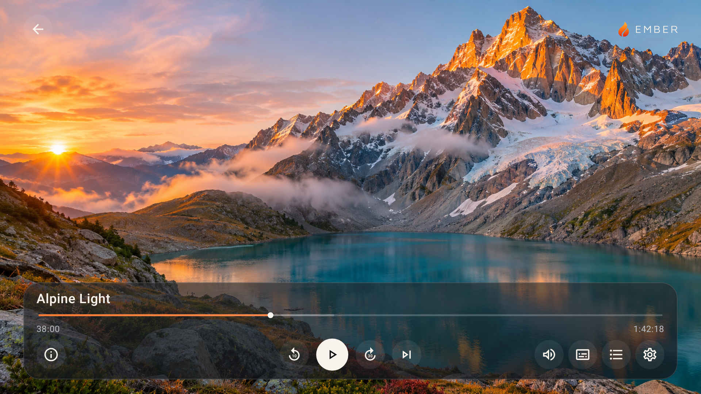
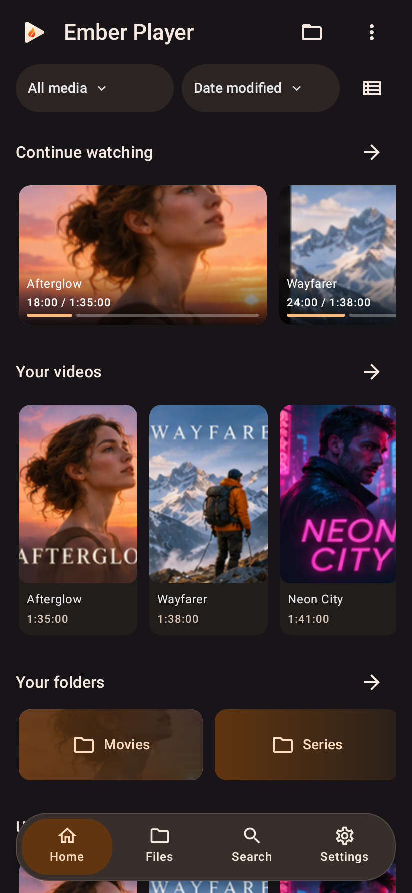
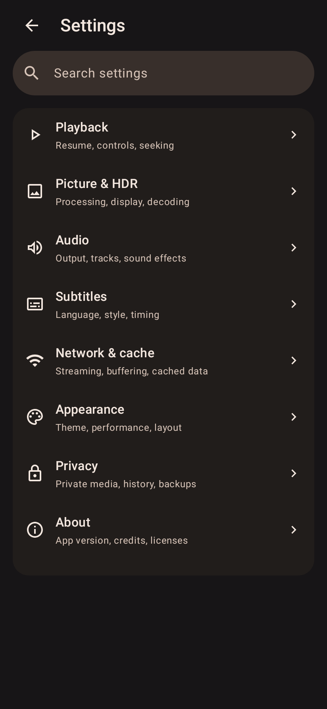
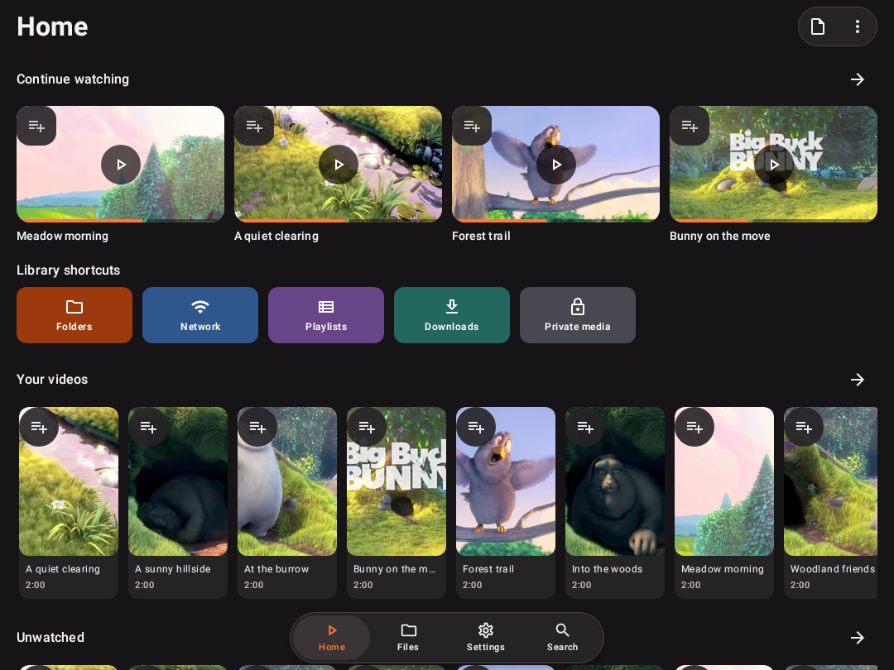
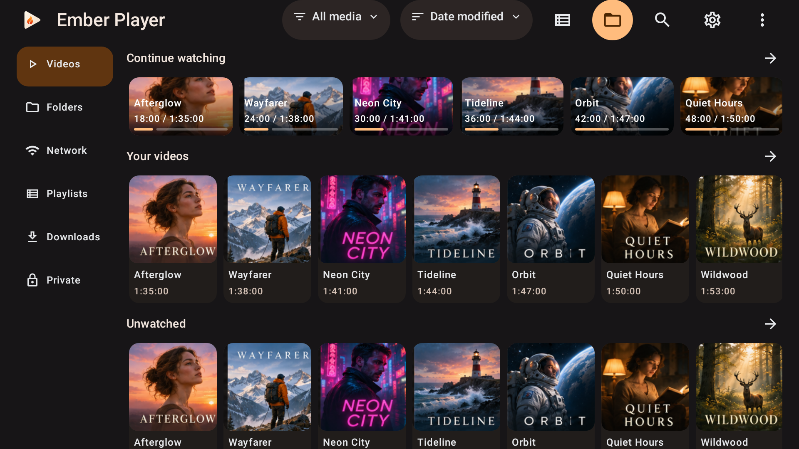

<p align="center">
  
</p>

<p align="center">
  A media player for Android phones, tablets and TVs.<br />
  Local files, network libraries and streams. Touch and remote controls. No ads.
</p>

<p align="center">
  <a href="https://github.com/PrimeN/Ember-Player/actions/workflows/android.yml?query=branch%3Amain"></a>
  <a href="https://github.com/PrimeN/Ember-Player/releases/latest"></a>
  
  
  <a href="LICENSE"></a>
</p>

<p align="center">
  <a href="https://github.com/PrimeN/Ember-Player/stargazers"></a>
  <a href="https://github.com/PrimeN/Ember-Player/network/members"></a>
  <a href="https://github.com/PrimeN/Ember-Player/issues"></a>
  <a href="https://github.com/PrimeN/Ember-Player/commits/main/"></a>
</p>

<p align="center">
  <a href="https://github.com/PrimeN/Ember-Player/releases/latest">Download</a> ·
  <a href="#screenshots">Screenshots</a> ·
  <a href="docs/features.md">Features</a> ·
  <a href="docs/building.md">Build</a> ·
  <a href="docs/README.md">Guides</a> ·
  <a href="https://github.com/PrimeN/Ember-Player/issues/new?title=%5BBug%5D%20">Report a bug</a>
</p>

## Made for your media

Ember Player brings a warm charcoal-and-amber interface to your own media. Pick
up where you stopped, browse saved folders or open a network stream. The library
adapts from a phone dock to a dense tablet layout and a remote-friendly TV sidebar.
Day/night palettes, searchable settings and independent playback-control layouts
keep the experience consistent across screens.

Local playback needs **no account or API key**. Optional network and subtitle tools
are enabled when you choose to use them. See [privacy and local data](docs/privacy.md).

| | What is included |
| --- | --- |
| **Playback** | Standard Media3/Nextlib and Compatibility libmpv engines, automatic routing and remembered working decoder choices |
| **Your library** | Continue watching, compact media shelves, saved folders, filename search, playlists, watched-state filters and grid/list views |
| **Files and servers** | Android file picker, mounted USB, read-only FAT32 USB browsing, SMB, SFTP, WebDAV, FTP and FTPS |
| **Sound and picture** | Track selection, passthrough, delay controls, equalizer, night listening, picture profiles, optional upscaling and tone mapping |
| **Subtitles** | Embedded and external captions, custom fonts and styles, timing controls, dual subtitles in Compatibility and optional on-device assistance |
| **Playback tools** | Exact seeking, custom speed, gestures, chapters, bookmarks, A–B repeat, queues, sleep timer, picture-in-picture and optional background audio |
| **Beyond the screen** | Optional Google Cast and DLNA, resumable direct-file downloads, screenshots and MP4 clip export |
| **Privacy** | PIN-protected private area, encrypted sensitive storage and library index, password-encrypted settings backups |

[Explore the full feature guide →](docs/features.md)

## Screenshots

Current app views with representative media. Media shown here is illustrative
and is not supplied with the app.

<p align="center">
  
</p>

<table>
  <tr>
    <th align="center">Phone library</th>
    <th align="center">Settings</th>
  </tr>
  <tr>
    <td align="center"></td>
    <td align="center"></td>
  </tr>
</table>

<details open>
  <summary><strong>Tablet library</strong></summary>
  <p></p>
</details>

<details open>
  <summary><strong>TV library</strong></summary>
  <p></p>
</details>

## Get started

Ember Player supports **Android 10 or newer** on **ARM64 and ARM32**. Phones and
tablets use touch controls; TVs support remotes and controllers.

Download the APK from the [latest release](https://github.com/PrimeN/Ember-Player/releases/latest)
and install it on your device. The current release is **0.7.5**;
[the changelog](CHANGELOG.md) describes its features and requirements.

Development happens on [`beta`](https://github.com/PrimeN/Ember-Player/tree/beta).
Code pushes build and validate the app, with unsigned APK artifacts. Publishing
a signed release requires an explicit version tag or manual request and approval
through the protected release-signing Environment.

To build the preview with JDK 21 and Android SDK platform 37:

```sh
git clone --branch beta https://github.com/PrimeN/Ember-Player.git
cd Ember-Player
./gradlew testDebugUnitTest assembleDebug
```

[Build instructions and native components →](docs/building.md)

## Format and device support

Ember combines Android's decoders with bundled software playback. Common
containers include MP4, MKV, WebM, AVI, MOV and MPEG-TS. Software audio includes
AC-3, E-AC-3, DTS and TrueHD. Standard also supports selected MPEG-H streams as
stereo PCM and unencrypted IAMF in MP4 using Opus, FLAC or PCM.

HDR10+, Dolby Vision, encoded surround output and device-only codecs depend on
the hardware, output path and selected engine. There is no bundled software AC-4
decoder. AAC-based/encrypted IAMF and Dolby Vision full enhancement-layer playback
are not advertised as universally supported. Casting requires a receiver that
supports the media; it does not transcode video.

[Playback details and limits →](docs/features.md) ·
[Dependency and source inventory →](player-dependencies.md)

## Help and contribute

Found a problem? [Report a bug](https://github.com/PrimeN/Ember-Player/issues/new?title=%5BBug%5D%20)
with the app version, device, Android version and steps to reproduce it. Include
engine and codec details for playback problems. Remove credentials and private
addresses from logs and screenshots.

[Suggest a feature](https://github.com/PrimeN/Ember-Player/issues/new?title=%5BFeature%5D%20)
or contribute a focused pull request against `beta`. The Android workflow checks
functional regressions, the optimized build, lint and native packaging.

[Support and contribution guide →](docs/contributing.md)

## License

Ember Player is distributed under the [GNU GPL v3](LICENSE). Dependency license
texts are included in the app under **Settings → About**. Pinned source revisions,
modifications and native rebuild instructions are documented in
[Playback dependencies and source](player-dependencies.md).

Service names, codec names and logos are trademarks of their respective owners.
Their inclusion does not imply endorsement.
